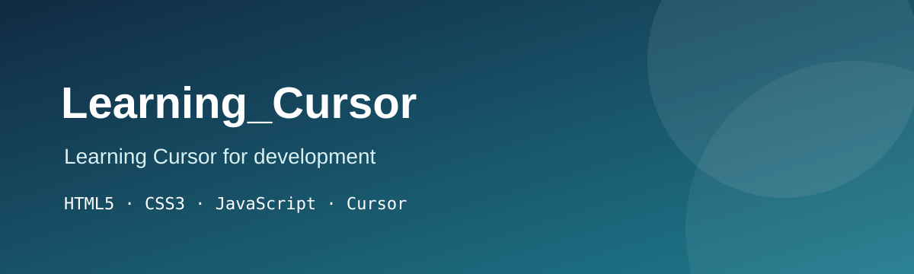

# Learning_Cursor 💻

<p align="center">
	
	<br>
	
	
	
	
	<br>
	
	<br>
	<a href="https://github.com/SueSystems/cursor_learning"></a>
	<a href="https://github.com/SueSystems/cursor_learning"></a>
	<a href="https://github.com/SueSystems/cursor_learning"></a>
	<a href="https://github.com/SueSystems/cursor_learning"></a>
</p>

A practice project for learning how to develop with the Cursor AI code editor.

## 📚 Table of Contents

- [🎯 Objective](#-objective)
- [🛠️ Technologies Used](#-technologies-used)
- [📁 Project Structure](#-project-structure)
- [🚀 Getting Started](#-getting-started)
- [🤝 Contributing](#-contributing)
- [⭐ Rate This Project](#-rate-this-project)
- [📄 License](#-license)
- [👤 Author](#-author)
- [🙏 Acknowledgements](#-acknowledgements)

## 🎯 Objective

The main objective of this project is to practice using the Cursor AI code editor for software development. I chose Cursor because it combines a familiar code editor with helpful AI tools that can make learning, experimenting, and solving problems more approachable.

### Learning goals

- Use Cursor Chat, Composer, and inline edit (`Ctrl+K`)
- Write effective prompts to generate and refactor code
- Debug with AI help
- Structure a Vanilla JS/HTML/CSS project
- Use Git and GitHub from inside Cursor
- Deploy a static site with GitHub Pages

### What I learned

- [ ] Use Cursor Chat, Composer, and inline edit (`Ctrl+K`)
- [ ] Write effective prompts to generate and refactor code
- [ ] Debug with AI help
- [ ] Structure a Vanilla JS/HTML/CSS project
- [ ] Use Git and GitHub from inside Cursor
- [ ] Deploy a static site with GitHub Pages

## 🛠️ Technologies Used

| Technology | Purpose | Icon |
| --- | --- | --- |
| HTML5 | Page structure and content |  |
| CSS3 | Styling, layout (Flexbox/Grid), and responsive design |  |
| Vanilla JavaScript (ES6+) | Interactivity and logic, with no frameworks |  |
| Cursor | AI-powered code editor used for development |  |
| Git & GitHub | Version control and hosting |   |
| GitHub Pages | Live deployment |  |

> "Vanilla" means plain JavaScript with no libraries or frameworks like React or Vue.

## 📁 Project Structure

```text
cursor_learning/
├── .github/
│   └── ISSUE_TEMPLATE/
│       ├── bug_report.md
│       └── feature_request.md
├── .cursor/
│   └── rules/
│       ├── Comment-demo.mdc
│       ├── coding-standards.mdc
│       ├── no-frameworks.mdc
│       └── project-structure.mdc
├── assets/
│   └── readme/
│       └── banner.svg
├── tests/
│   └── test-runner.html
├── .gitignore
├── CODE_OF_CONDUCT.md
├── CONTRIBUTING.md
├── LICENSE
├── README.md
├── index.html
├── script.js
└── styles.css
```

## 🚀 Getting Started

### 🌐 Live Site

Visit the live project on GitHub Pages:

<p align="center">
	<a href="https://suesystems.github.io/cursor_learning/">
		
	</a>
</p>

### 📥 Download the Project

#### Option A: Download ZIP

1. Open the [project repository](https://github.com/SueSystems/cursor_learning).
2. Select the green **Code** button.
3. Select **Download ZIP**.
4. Extract the downloaded ZIP file.

#### Option B: Clone with Git

```bash
git clone https://github.com/SueSystems/cursor_learning
```

### 💻 Launching the Application

#### 🪟 Windows

The easiest option is to open the project folder and double-click `index.html`.

Using Git Bash or Command Prompt:

```bash
cd cursor_learning
start index.html
```

You can also use the Cursor or VS Code **Live Server** extension. With Node.js installed, you can run an optional local server:

```bash
npx serve .
```

#### 🍎 macOS

```bash
cd cursor_learning
open index.html
```

Or run a local server:

```bash
python3 -m http.server 8000
```

Then visit `http://localhost:8000` in your browser.

#### 🐧 Linux

```bash
cd cursor_learning
xdg-open index.html
```

Or run a local server:

```bash
python3 -m http.server 8000
```

Then visit `http://localhost:8000` in your browser.

#### ☁️ GitHub Codespaces

1. Open the [project repository](https://github.com/SueSystems/cursor_learning) on GitHub.
2. Select **Code**, open the **Codespaces** tab, and select **Create codespace on main**.
3. Wait for the Codespace to finish loading.
4. In the integrated terminal, start a local server:

```bash
python3 -m http.server 8000
```

5. Open the **Ports** panel in Codespaces.
6. Find port `8000`, select the globe icon or **Open in Browser**, and preview the project.

### ✅ Requirements

- A modern browser: Chrome, Edge, Firefox, or Safari
- Git, Node.js, and Python are optional
- No build step is needed

## 🤝 Contributing

Contributions, bug reports, feature ideas, and documentation improvements are welcome. Please read the [Contributing Guide](CONTRIBUTING.md) for the workflow, coding rules, commit conventions, and Pull Request requirements. Our community standards are described in the [Code of Conduct](CODE_OF_CONDUCT.md).

## ⭐ Rate This Project

Enjoyed exploring the app? Please rate the project and share your feedback. Your thoughts help improve the project and make the learning experience better for everyone.

### Star this repo

<p align="center">
	<a href="https://github.com/SueSystems/cursor_learning/stargazers">
		
	</a>
</p>

### Rating scale

| Rating | Label |
| --- | --- |
| ⭐ | Needs work |
| ⭐⭐ | Fair |
| ⭐⭐⭐ | Good |
| ⭐⭐⭐⭐ | Very good |
| ⭐⭐⭐⭐⭐ | Excellent |

### Submit your rating

- [GitHub Discussions](https://github.com/SueSystems/cursor_learning/discussions) — share your rating in the **Ratings & Feedback** category.
- [GOOGLE_FORM_OR_TALLY_LINK](GOOGLE_FORM_OR_TALLY_LINK)
- [Open an Issue with the `feedback` label](https://github.com/SueSystems/cursor_learning/issues/new?labels=feedback)

### What to rate

- Design/UI
- Ease of use
- Performance
- Mobile experience
- Overall experience

## 📄 License

This project is licensed under the [MIT License](LICENSE).

## 👤 Author

Sewe Susan: [GitHub @Suesystems](https://github.com/SueSystems) · [LinkedIn](https://www.linkedin.com/in/sewe-susan/)

## 🙏 Acknowledgements

- [Cursor](https://www.cursor.com/)
- [shields.io](https://shields.io/)
- [skillicons.dev](https://skillicons.dev/)

<p align="center">Made with ❤️ using Cursor</p>
